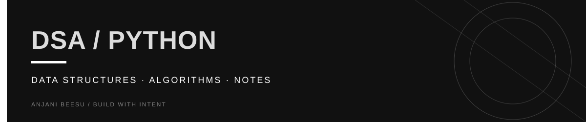

<!-- Visual identity: near-black, warm ivory, and butter yellow. -->

  

<a href="https://github.com/AnjaniBeesu">ANJANI BEESU</a> / <a href="https://www.linkedin.com/in/anjanibeesu/">LINKEDIN</a> / <a href="https://portfolio-theta-olive-54.vercel.app/">PORTFOLIO</a>

---

# DSA Notes (Python)

Welcome to my **Data Structures & Algorithms (DSA)** notes repository.

## About

This repository contains my personal DSA notes written while learning and practicing **Python**. The goal is to build a strong understanding of fundamental concepts and prepare for coding interviews.

## Topics Covered

* Data Structures

  * Arrays (done)
  * Strings (done)
  * Linked Lists (done)
  * Stacks (done)
  * Queues (in progress - ld )
  * Hash Maps & Sets
  * Trees
  * Heaps
  * Graphs
  * Tries
* Algorithms

  * Searching
  * Sorting
  * Recursion
  * Backtracking
  * Binary Search
  * Two Pointers
  * Sliding Window
  * Prefix Sum
  * Greedy
  * Dynamic Programming
  * Graph Algorithms
* Complexity Analysis

  * Big O Notation (done)
  * Time Complexity (done)
  * Space Complexity (in progress)

## Purpose

This repository serves as my learning journal and interview preparation resource. Every topic is accompanied by explanations, examples, and relevant LeetCode practice problems to reinforce understanding.

---

**Language:** Python 

**Status:** Continuously updated as I learn and solve more problems.
